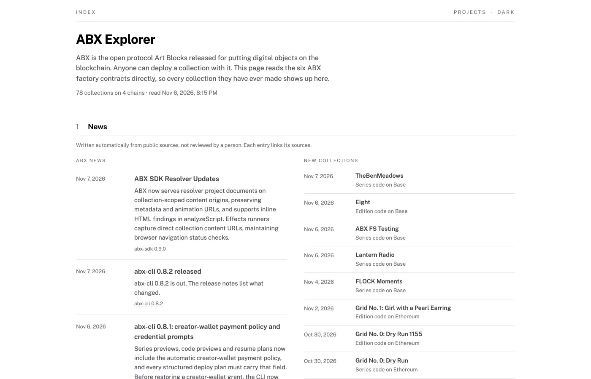
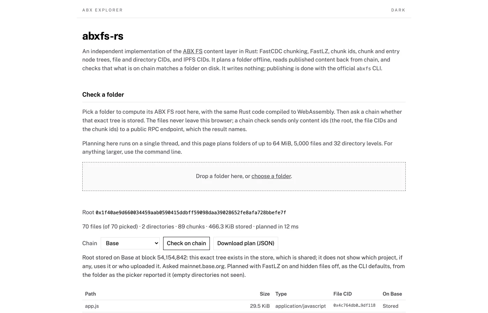
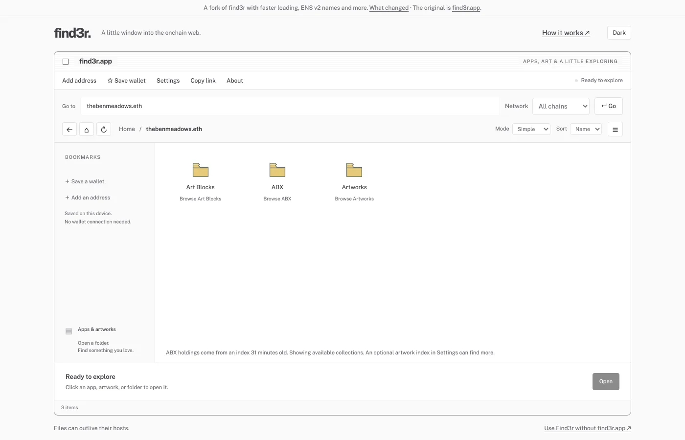

In October I minted [hollerith](https://hollerith.thebenmeadows.com/) as an ABX code series on Ethereum. ABX is the open protocol Art Blocks released this year for deploying collections, with the same factory contracts at the same addresses on every chain it supports. The piece is a punch card in IBM 029 Hollerith code, one card for every person I met in Marfa. ABX stores the program on chain, and a Solidity contract draws each card from it. No server is involved in a card. 126 cards exist as I write this, most of them minted by the visitors themselves from their phones. A typical claim cost about 0.0002 ETH of gas at the 0.3 gwei cap the show key ran under.

I built three more things with Claude Code between November 5 and 7.

**ABX Explorer.** [abx.thebenmeadows.com](https://abx.thebenmeadows.com/) is a static page. A Cloudflare Worker reads the six ABX factory contracts' Deployed events every 15 minutes and writes the directory the page renders, so every collection the factories deployed on Ethereum, Base, Arbitrum and Robinhood Chain is listed: 78 as I write this. Names and images are read from each collection's own `contractURI()` and `tokenURI()` data URIs and supply from the contracts, so a collection that never registered with Art Blocks' resolver is listed like any other. Once an hour the Worker also writes a news feed from the ABX changelogs. The news is written by a machine. The page labels it that way, and every entry carries a link to what it was written from.

The Worker publishes an owner index too: which wallets hold which of 65 collections on Ethereum, Base, Arbitrum and Base Sepolia, rebuilt every 15 minutes, 243 KB and 4,375 owner rows. It fits the Workers free plan (33 to 50 ms of CPU per run). The find3r fork below reads this index instead of asking Art Blocks' resolver about 63 collections one by one for every wallet it opens.

**ABX FS and a Rust version.** ABX FS (formerly BAMFS) is Art Blocks' content-addressed file store on Ethereum, Base and Arbitrum. Files are cut into chunks with FastCDC, each chunk is compressed with FastLZ where that shrinks it and stored as contract code, and directories are trees of hashes ending in one root. Art Blocks publishes the SDK and the CLI in TypeScript. I wanted an independent check on them, so [abxfs-rs](https://github.com/mdws-org/abxfs-rs) is a second version of the content layer, written in Rust. It plans a folder offline: chunk boundaries, compression, every id, the root. Given a root it will also pull the whole tree back from a chain, hash-checking every chunk as it arrives, or compare that tree with a folder on disk. On six reference sets and on real roots it produces the same ids as the official SDK. Planning runs 12 to 20 times faster than the SDK. Reading a 5.3 MB file from Base Sepolia took 3.1 s where the official CLI took 8.6 s on the same machine. The SDK picks a file's MIME type by looking its extension up in a plain JavaScript object, which means a file called `x.constructor` is typed as `function Object() { [native code] }`, and that string ends up inside its CID.

The same code compiled to WebAssembly runs at [fs.abx.thebenmeadows.com](https://fs.abx.thebenmeadows.com/). The page plans a folder you drop on it, shows the root it would have, and reports whether that root is stored on a chain. I also stored a snapshot of the ABX Explorer site on ABX FS: 70 files, 466 KiB stored, 23 transactions, about 0.0011 ETH on Base, root `0x1f40ae9d660034459aab0590415ddbff59098daa39028652fe8afa728bbefe7f`, readable at the [ABX FS gateway](https://fs.abx.io/g/p/8453/0x6cb8206e55cf52e069fd3ed3d75b5d391934693c/1/latest/) and verified back from chain by the Rust checker.

**A find3r fork.** [find3r](https://find3r.app/) is Snowfro's static browser for onchain files, Art Blocks artworks and ABX collections: a wallet address in, folders out, every byte read over public RPC, with no server of its own. It is itself published on BAMFS (on Base Sepolia), so [the fork](https://find3r.thebenmeadows.com/) started from the 23 files read back from chain with their hashes checked, kept on an `upstream` branch byte for byte. The fork's [changes page](https://find3r.thebenmeadows.com/changes) lists each change with its commit.

1) ENS names go through the Universal Resolver, so ENS v2 names (live on mainnet since October 27) and offchain names resolve, and the address box takes any ENS name rather than only `.eth`. The original asks the ENS registry directly for a resolver, which fails for names that moved to ENS v2 and for offchain names. Typing thebenmeadows.eth into the original gets the message "no direct onchain resolver".

2) find3r waits a quarter of a second between RPC requests and asks each chain for its id and block number again before every one of them. The fork pins one block per chain per page load, runs requests six at a time, batches balance checks through Multicall3 and reads the owner index above instead of 63 resolver calls. Measured on the live hosts with the same wallet on all chains: 2.7 s and 33 requests, against 8.2 s and 116 on find3r.app.

3) ENS primary names appear next to addresses: an opened wallet, saved wallets without a label of their own, an artwork's owner and artist. A name shows only when it resolves forward to the same address, and a switch in Settings turns them off. Collection types (ERC-721 or 1155, ABX version) are remembered on the device for 30 days and re-read in Multicall3 batches once per visit before use, since a proxy upgrade can change a type. And it is restyled to match thebenmeadows.com, with a dark theme that follows the system setting and a Light/Dark switch in the header.

Before launch I had the work read by outside models, six of them, in two rounds. The records are in the repositories. Bug reports go to each repository's issues: [find3r](https://github.com/mdws-org/find3r/issues), [abx-explorer](https://github.com/mdws-org/abx-explorer/issues), [abxfs-rs](https://github.com/mdws-org/abxfs-rs/issues).
